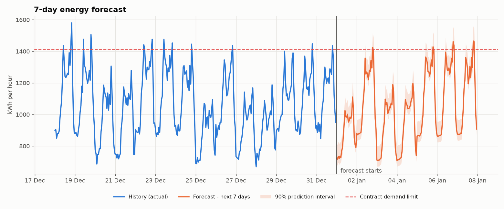
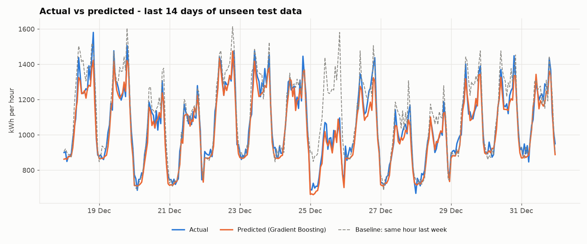
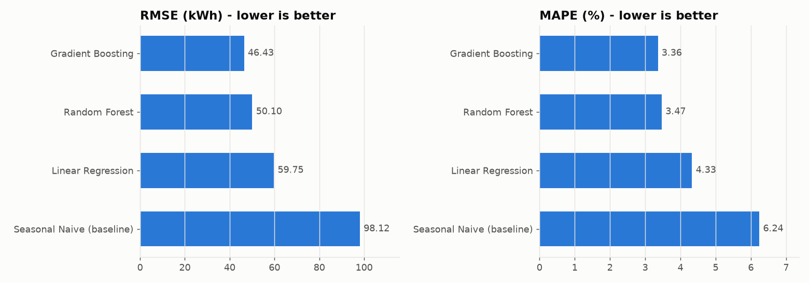
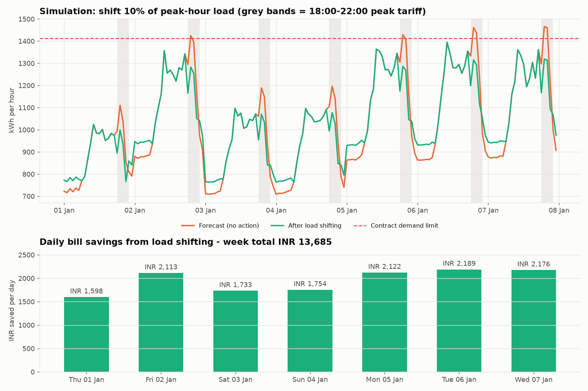
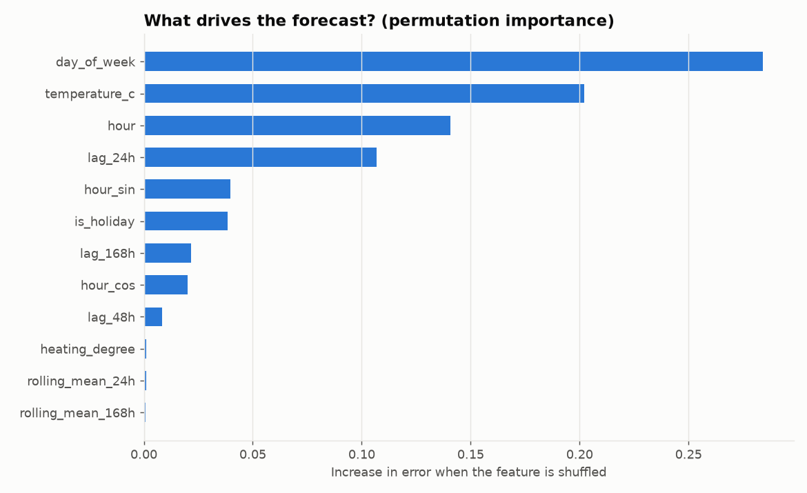
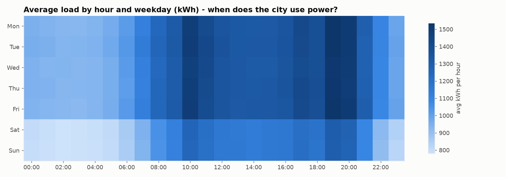
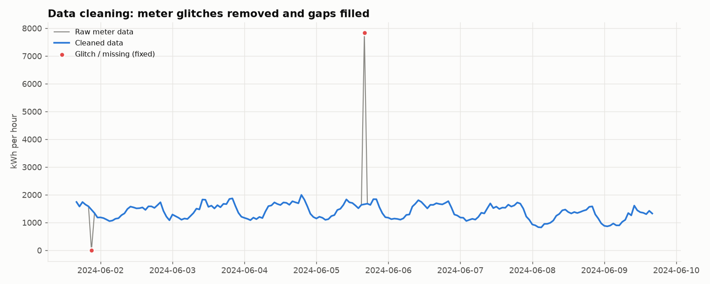
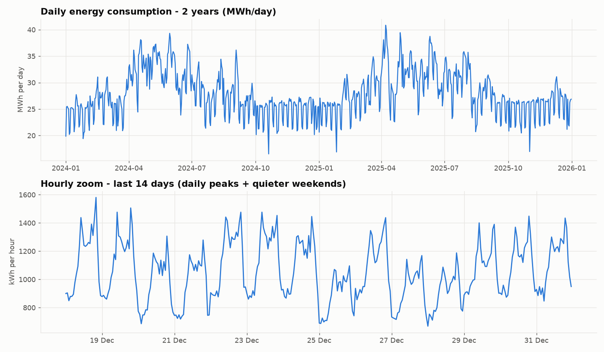
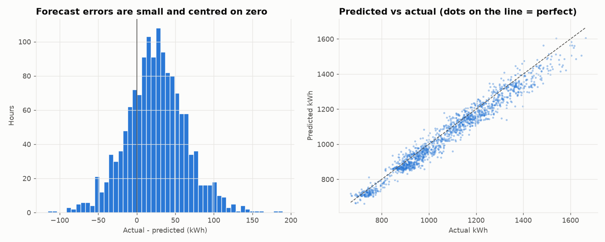

# ⚡ AI-Powered Energy Consumption Forecasting System

> Forecasts hourly electricity demand 7 days ahead with machine learning, then turns the forecast into business decisions: peak-demand alerts, load-shifting savings and a power-procurement backtest.




---

## 📌 Overview

Electricity can't be stored cheaply, so utilities, factories and data centres must **predict demand before it happens**. This project builds a complete forecasting pipeline on **2 years of hourly smart-meter data (17,544 readings)** from a simulated city zone:

`raw meter data → cleaning → feature engineering → 4 models compared → best model → 7-day forecast → business simulation`

| Result (on 60 days of unseen data) | Value |
|---|---|
| Best model | **Gradient Boosting** |
| Accuracy (MAPE) | **3.36 % error**, about 96.6 % accurate |
| R² | **0.95** |
| Error vs. naive baseline | **RMSE 46.4 vs 98.1 kWh, 53 % lower** |
| Procurement penalty saved (60 days) | **INR 92,079 (46.5 %)** |
| Load-shifting savings | **INR 13,685 / week, about INR 7.1 lakh / year** |
| Peak-limit violations | **6 hours → 0 hours** |

## ❓ Problem Statement

An electricity provider for a city zone needs to know **how much energy will be consumed every hour for the next week** so it can:
1. buy the right amount of power on the day-ahead market (buying too much or too little is penalised),
2. warn operators before demand crosses the **contract demand limit**,
3. plan **load shifting** (pre-cooling, EV charging, batch jobs) from expensive peak hours to cheap off-peak hours.

## 🏭 Industry Relevance

| Industry | How this forecast is used |
|---|---|
| Smart cities | Plan street-light, metro and water-pump schedules; avoid feeder overloads |
| Electricity boards / DISCOMs | Day-ahead power purchase, scheduling of generators, grid stability |
| Manufacturing plants | Avoid maximum-demand penalty charges, schedule heavy machines off-peak |
| Data centres | Plan cooling capacity, negotiate power contracts, cut carbon footprint |
| Renewable energy companies | Balance solar/wind supply with demand, size battery storage |

## 🛠 Tech Stack

| Layer | Tools |
|---|---|
| Language | Python 3.10+ |
| Data | Pandas, NumPy |
| Machine learning | scikit-learn: Linear Regression, Random Forest, HistGradientBoosting |
| Visualisation | Matplotlib (colour-blind-safe palette) |
| Persistence | joblib (model), JSON/CSV (reports) |
| Quality | pytest (incl. a data-leakage test), logging |

No GPU needed. The full pipeline runs in **about 1 minute on a laptop**.

## 📊 Dataset

The data comes from a **virtual simulation** of a smart-meter feed, because real utility SCADA data is not public. The simulation (`src/data_generator.py`) uses the real drivers of electricity demand:

- **Daily routine:** morning ramp, office plateau, evening peak (~19:30)
- **Weekly routine:** weekends −18 %, public holidays −22 %
- **Weather:** tropical temperature cycle. Every °C above 24 °C adds air-conditioning load
- **Growth:** +3 % per year
- **Noise + real-world data problems:** 115 missing readings, a 10-hour outage, 25 meter glitches (spikes and zeros), 15 duplicate rows

| Column | Description |
|---|---|
| `timestamp` | Hourly time stamp (2024-01-01 → 2025-12-31) |
| `energy_kwh` | Energy consumed in that hour (target) |
| `temperature_c` | Outdoor temperature |
| `is_holiday` | 1 on a public holiday |

> 🔁 **Using a real dataset:** the pipeline also works with public data such as Kaggle's *Hourly Energy Consumption (PJM)*. Rename the columns to the ones above and point `RAW_DATA_FILE` in `src/config.py` to the file.

## 🏗 Architecture

```
 ┌────────────────────┐   ┌───────────────────┐   ┌──────────────────────┐
 │ 1. DATA SOURCE      │──▶│ 2. PREPROCESSING   │──▶│ 3. FEATURE ENGINEERING│
 │ data_generator.py   │   │ preprocessing.py   │   │ features.py           │
 │ smart-meter CSV +   │   │ dedupe · fill gaps │   │ calendar · weather ·  │
 │ weather forecast    │   │ outlier removal    │   │ lags 24h/48h/168h     │
 └────────────────────┘   └───────────────────┘   └──────────┬───────────┘
                                                              ▼
 ┌────────────────────┐   ┌───────────────────┐   ┌──────────────────────┐
 │ 6. BUSINESS SIM     │◀──│ 5. FORECASTING     │◀──│ 4. TRAIN + EVALUATE   │
 │ simulation.py       │   │ forecast.py        │   │ train.py · evaluate.py│
 │ alerts · shifting · │   │ recursive 7-day    │   │ 4 models, time split, │
 │ procurement backtest│   │ + 90% interval     │   │ best saved (joblib)   │
 └─────────┬──────────┘   └───────────────────┘   └──────────────────────┘
           ▼
 ┌──────────────────────────────────────────────┐
 │ 7. OUTPUTS: visualize.py → images/ (10 charts) │
 │             outputs/ (CSV reports, log, JSON)  │
 └──────────────────────────────────────────────┘
```

## 📁 Project Structure

```
AI-Energy-Forecasting/
├── data/
│   ├── raw/                  # energy_consumption.csv, weather_forecast.csv
│   └── processed/            # energy_clean.csv (generated)
├── notebooks/
│   └── 01_exploratory_analysis.ipynb
├── src/
│   ├── config.py             # all settings in one place
│   ├── data_generator.py     # virtual smart-meter simulation
│   ├── data_loader.py        # load + profile raw data
│   ├── preprocessing.py      # cleaning
│   ├── features.py           # feature engineering
│   ├── train.py              # train, compare, save best model
│   ├── evaluate.py           # MAE, RMSE, MAPE, R²
│   ├── forecast.py           # 7-day recursive forecast
│   ├── simulation.py         # business decisions & savings
│   └── visualize.py          # all charts
├── models/                   # best_model.joblib + model_metadata.json
├── outputs/                  # metrics, predictions, reports, run log
├── images/                   # charts used in this README
├── docs/                     # project guide, GitHub guide
├── tests/                    # pytest sanity + leakage tests
├── main.py                   # one-command pipeline
├── requirements.txt
└── .gitignore
```

## ⚙️ Installation

```bash
git clone https://github.com/SNischayPrasad/AI-Energy-Forecasting.git
cd AI-Energy-Forecasting
python -m venv venv
# Windows:      venv\Scripts\activate
# Mac / Linux:  source venv/bin/activate
pip install -r requirements.txt
```

## ▶️ Usage

```bash
python main.py                    # full pipeline (about 1 min)
python main.py --step generate    # only create the dataset
python main.py --step train       # clean + train + evaluate + charts 01-08
python main.py --step forecast    # 7-day forecast + business simulation + charts 09-10
python -m pytest -q               # run tests
```

## 📈 Results

### Model leaderboard (test set = last 60 days, never seen during training)

| Model | MAE (kWh) | RMSE (kWh) | MAPE % | R² |
|---|---|---|---|---|
| **Gradient Boosting** ✅ | **36.80** | **46.43** | **3.36** | **0.950** |
| Random Forest | 38.38 | 50.10 | 3.47 | 0.942 |
| Linear Regression | 46.97 | 59.75 | 4.33 | 0.917 |
| Seasonal Naive (baseline) | 68.78 | 98.12 | 6.24 | 0.777 |

### Energy manager's weekly briefing (auto-generated, `outputs/business_report.txt`)

```
1) DEMAND OUTLOOK      Total 174,221 kWh · peak 1,465.5 kWh on 07 Jan 19:00 · limit 1,412 kWh/h
2) PEAK ALERTS         6 hours above limit → 0 after load shifting
3) LOAD SHIFTING       Weekly bill INR 1,195,776 → 1,182,090  (saves INR 13,685/week)
4) PROCUREMENT         Imbalance penalty naive INR 198,073 vs AI INR 105,994 → 46.5 % saved
```

## 🖼 Screenshots

| | |
|---|---|
| **Actual vs predicted**  | **Model comparison**  |
| **Business simulation**  | **Feature importance**  |
| **Load by hour & weekday**  | **Data cleaning**  |
| **2-year history**  | **Error analysis**  |

## 🎓 Learning Outcomes

- Framing a **business problem** (cost, peak penalties) as an ML forecasting task
- **Time-series cleaning:** duplicates, gaps, robust (MAD-based) outlier detection
- **Feature engineering** for demand: cyclical encoding, degree-days, lag/rolling features **without data leakage**
- **Correct validation:** chronological train/test split and comparison against a naive baseline
- **Recursive multi-step forecasting** with prediction intervals
- Turning model output into **₹ savings and operational decisions**
- Writing **modular, tested, reproducible** Python projects

## 🚀 Future Improvements

- Plug in a real public dataset (PJM, UCI Household Power) and a live weather API
- Add LSTM / Prophet models and time-series cross-validation
- Streamlit dashboard and a FastAPI endpoint for live forecasts
- Schedule daily retraining (GitHub Actions / Airflow)

## 👤 Author

**Sadhanala Nischay Prasad** · [GitHub](https://github.com/SNischayPrasad)

*Built as a hands-on, industry-style project. Data is simulated for learning purposes.*
